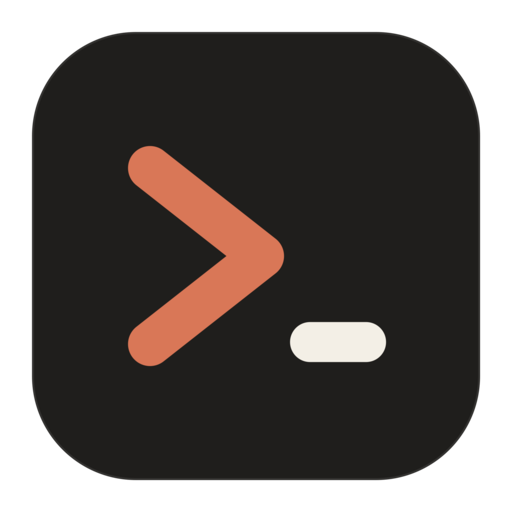
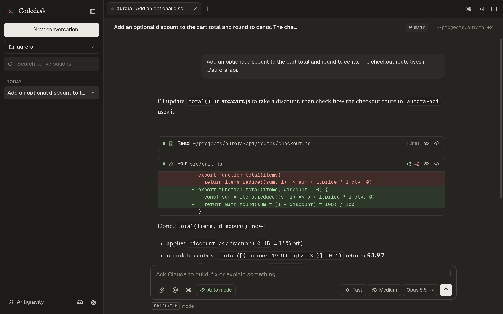
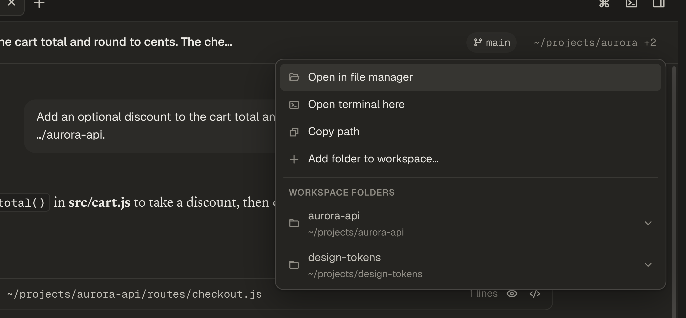
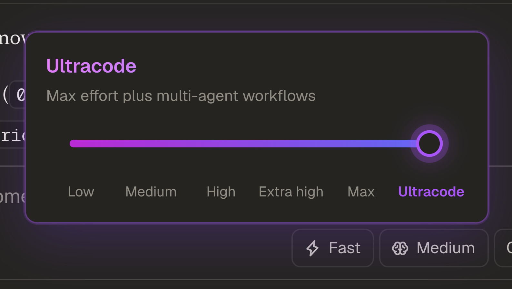
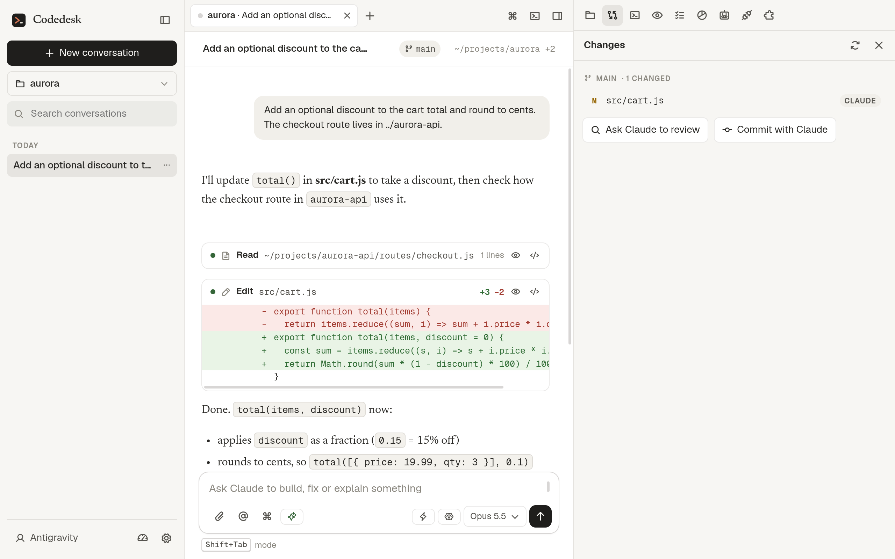

<div align="center">



# Codedesk

**A desktop workspace for Claude Code.**

Uses the `claude` CLI you already have installed, along with your login, settings, CLAUDE.md, hooks, skills, plugins, MCP servers and slash commands.

[](#-install)
[](#-install)
[](#-install)
<br>
[](https://www.electronjs.org)
[](https://docs.claude.com/en/api/agent-sdk/overview)
[](ui)
[](package.json)

<br>



</div>

<br>

## ✨ Highlights

<table>
<tr>
<td width="50%" valign="top">

### 🗂️ Workspaces
Add more folders to a project and Claude can read and edit all of them in the same conversation: your app, its API, a shared design system. The list is saved per project, so every conversation in it, new or resumed, sees the same folders.

</td>
<td width="50%" valign="top">

### 🧠 Effort and models
A slider from **Low** to **Max**, plus **Ultracode**. Model picker (newest first), fast mode, and Gemini through Antigravity.

</td>
</tr>
<tr>
<td valign="top">

### 🔍 Review everything
Inline diffs with line numbers, permission prompts (keys `1` `2` `3`), plan approval, to-dos, and subagent output.

</td>
<td valign="top">

### 🎨 Make it yours
Light, dark or system theme. Four backgrounds, accent colors, fonts, density, corner style and custom CSS.

</td>
</tr>
</table>

<br>

## 🗂️ Workspaces: several folders, one conversation



Click the project path in the chat header (or run `/add-dir`) and choose **Add folder to workspace…**. The header then shows the project path with a count, like `~/projects/aurora +2`. Each added folder has a menu to open it in your file manager or remove it from the workspace.

<br>

## 🧠 Effort, from quick to Ultracode

<table>
<tr>
<td width="55%"></td>
<td valign="middle">

Click the effort chip in the composer and drag the slider or click a level.
**Ultracode** runs at max effort plus multi-agent workflows.

New conversations start in **Auto** mode, **Medium** effort, **Opus 5.5**. You can change these under Settings.

</td>
</tr>
</table>

<br>

## 🌗 Light or dark



<br>

## 📦 Install

<table>
<tr><th>❄️ NixOS / Nix</th><th>🖥️ Everything else</th></tr>
<tr>
<td valign="top">

```sh
nix run .
```

Or add `packages.${system}.default` from this flake to your system packages to get a **Codedesk** entry in your app launcher.

</td>
<td valign="top">

```sh
npm install
npm start          # run it
npm run dist       # AppImage / deb / rpm / dmg / exe → dist/
```

</td>
</tr>
</table>

> [!NOTE]
> You need Claude Code installed and signed in (`claude auth login`), or you can use the app's **Sign in** button.
> `CLAUDE_PATH` overrides which `claude` binary is used.

<br>

## 📱 Use it from your phone

Control the Codedesk on your PC from anywhere, with the same look: every project, workspace folder, account, conversation and the ones running right now. Nothing opens a port and your phone does not need to be on the same wifi.

Codedesk only listens on `127.0.0.1:4870` on the PC. A tunnel you set up reaches that port with outbound connections only.

**1. Tailscale (recommended).** Only your own devices can reach the PC.

1. Install Tailscale on the PC and the phone and sign in to the same account. On NixOS: `services.tailscale.enable = true;`, then `sudo tailscale up`.
2. In Codedesk open **Settings → Remote**, turn on **Allow remote access**, then press **Share over Tailscale**. If it asks for permission, run `sudo tailscale set --operator=$USER` once.
3. The pane shows an address like `https://your-pc.your-tailnet.ts.net`. Open it on the phone while Tailscale is connected.
4. Press **Pair a device** on the PC and type the code on the phone. The code works once and expires after 5 minutes. After pairing, use **Add to Home Screen** for a full-screen app.

Revoke any phone from the same pane.

**2. Cloudflare Tunnel (nothing to install on the phone).** Run `cloudflared tunnel --url http://127.0.0.1:4870` on the PC and open the `trycloudflare.com` address it prints. This address is public, so the pairing code is the only lock. Put Cloudflare Access with your email in front of a named tunnel to add a second one.

**Keep it reachable.** While remote access is on, closing the last window keeps Codedesk running. `codedesk --background` starts it without a window, for login autostart. With home-manager:

```nix
systemd.user.services.codedesk = {
  Unit.Description = "Codedesk";
  Service.ExecStart = "${pkgs.codedesk}/bin/codedesk --background";
  Install.WantedBy = [ "graphical-session.target" ];
};
```

**Limits.** Claude sign-in opens a browser, so accounts are added on the PC (switching and removing work from the phone). No notifications while the page is closed. Auto-continue after a limit only runs while the page that owns the conversation is open. Dev-server previews on `localhost` don't load on the phone. The PC must be on.

<br>

## 🧰 What's in it

<details open>
<summary><b>💬 Conversations and tabs</b></summary>

- **Tabs:** several conversations at once, each with its own project, model and permission mode.
- **Conversations:** browse by project, search, rename, fork, export to Markdown, delete, resume, pin.
- **Undo:** edit or retry any message (forks the conversation), or rewind code to before a message.
- **Working indicator:** elapsed time and output tokens (`Working… 1m 23s · ↓ 2.1k tokens`). A ↓ button jumps back to the newest output.

</details>

<details open>
<summary><b>⌨️ Composer</b></summary>

| Type | Does |
|---|---|
| `/` | Commands: built-in, skills, plugins, custom |
| `@` | Mention files, folders, agents |
| `!cmd` | Run a shell command and hand Claude the output |
| `#note` | Save a note to CLAUDE.md |
| `↑` `↓` / `Ctrl+R` | Prompt history / search it |
| `Ctrl+S` · `Esc Esc` · `Tab` | Stash prompt · clear · accept suggestion |

Paste or drop images and PDFs. Messages queue while Claude works.
Extra commands: `/context` `/status` `/rename` `/plan` `/branch` `/copy N` `/stats` `/add-dir`.

</details>

<details>
<summary><b>🎛️ Controls</b></summary>

Permission mode (`Shift+Tab`), model (`Alt+P`, newest first, older versions under "More models"), effort slider plus Ultracode, fast mode (`Alt+O`), stop (`Esc`), and rewind (`Esc Esc`).

</details>

<details>
<summary><b>✨ Gemini</b></summary>

Pick a Gemini model to run the tab through the Antigravity CLI (`agy`) with your Google sign-in. Install `agy`, then sign in from **Settings → Antigravity**. The model list comes from `agy models`. Permission modes map to agy's (Ask behaves like Accept edits). Gemini tabs have no fork or rewind.

</details>

<details>
<summary><b>🪟 Panels and editor</b></summary>

- **Files**, **Changes** (git status and diffs, discard, review or commit with Claude), **Terminal**, **Preview** (files, HTML/SVG/diagram artifacts, localhost dev servers), **Tasks**, **Context** usage, **MCP** servers (status, sign in, toggle, add/remove), **Plugins** (install, enable, update, marketplaces).
- **Editor:** editable, highlighted view with line numbers. `Ctrl+S` saves, `Tab`/`Shift+Tab` indent.
- **Agents:** browse subagents, mention them, or create one in `.claude/agents/`.
- **Rendering:** Markdown, syntax highlighting, LaTeX math, Mermaid diagrams.

</details>

<details>
<summary><b>📊 Usage and limits</b></summary>

Session and weekly limits with reset times, a per-product split, what used them, and this conversation's cost (gauge button, status bar, or `/usage`). If a limit stops Claude mid-task, it continues on its own once the limit resets, even after an app restart.

</details>

<details>
<summary><b>🧩 Everything else</b></summary>

Command palette (`Ctrl+K`), find (`Ctrl+F`), `/copy`, open files in your editor, your statusLine command, desktop notifications, and a sound when Claude is done. Shortcuts are listed under `/help`.

</details>

<br>

## 🪶 Light by design

Claude Code only starts for a tab once you type in it, stops after **15 idle minutes** (it resumes on its own), and the terminal and diagram engines load only when first used.

<br>

<div align="center">
<sub>Built with Electron and vanilla JS · Runs on your own Claude Code</sub>
</div>
